# Demo guide

Click-by-click steps for the presentation. Every step below was run in headless Chrome from a fresh **Reset demo**, with the screenshots it produced. Rerun it any time with `node scripts/demo-guide.mjs` (with the demo up): it clicks through every journey, prints what's on screen after each step and refreshes the screenshots in `docs/screenshots/demo-guide/`.

Each step is written as **where → what to click → what you should see**.

## Before you start

### URLs and ports

| What | URL | Port |
|---|---|---|
| CRED member app (use a narrow window or phone view) | http://localhost:3000 | 3000 |
| CRED console (admin) | http://localhost:3001 | 3001 |
| Control room | http://localhost:3001/demo | 3001 |
| ShopKart | http://localhost:3002 | 3002 |
| Partner sites (Mock Bank, SimUPI, SimAA, insurer, fund house, lender, health app) | http://localhost:3003 (directory); e.g. http://localhost:3003/bank?c=per_rohan | 3003 |
| cred-api | http://localhost:4000/status | 4000 |
| ecosystem-api | http://localhost:4100/status | 4100 |

### Logins and codes

| Where | How |
|---|---|
| Console | **`ops@cred.example`** / **`trust-first-demo`** → **Sign in** |
| CRED app | Tap the member's name on the sign-in screen (no password). To change member: **Profile** tab → **Switch member**, or in the control room tap the person, then **Show on phone**. |
| Every OTP (bank, lender e-sign, insurer) | Any 6 digits. The demo code is printed on the screen. |
| UPI PIN | **1234** |

### Reset

1. Terminal: `pnpm demo`. Wait for **✔ Demo ready** (all six services green).
2. Open four tabs: the CRED app, the console (sign in), the control room, ShopKart.
3. Before **each** journey: **Control room → Reset demo**. The log on the right shows *"Reset demo: both worlds reset to 2 Nov 2026"*. This also undoes rule changes, and the CRED app stays signed in.

The simulated date starts at **2 Nov 2026**. The CRED app updates live: you don't need to refresh it after something happens elsewhere.

---

## Journey 1 · Aarav buys a ₹1.5L laptop (Big-Spend Support, the golden path)

Sign in to the CRED app as **Aarav Mehta** and leave it open on Home.

| # | Where | Click | You should see |
|---|---|---|---|
| 1 | CRED app | (nothing) | Home: bill ₹46,849 due 5 Nov, card outstanding ₹72,348 (18% of limit). No offer. |
| 2 | ShopKart | **Shopping as** → **Aarav Mehta** → **Switch** | Header shows Aarav. |
| 3 | ShopKart | **Aero 14 Laptop · 16 GB · 1 TB** | Product page, ₹1,50,000. |
| 4 | ShopKart | **Buy now** | Checkout: "Deliver to Aarav Mehta". |
| 5 | ShopKart | **Credit or debit card**, then the saved card **Mock Bank VISA ···· 4821 (saved)** (it isn't pre-selected) → **Pay ₹1,50,000** | Redirect to Mock Bank. |
| 6 | Mock Bank (port 3003) | Type any 6 digits → **Confirm payment** | Back on ShopKart: order placed. |
| 7 | CRED app | (no refresh) | A **SMART SAVINGS** card arrives by itself: *"If you can't clear ₹1,50,000 by the due date, an EMI saves you ₹27,714 compared with carrying it"*, with **Not now** and **Turn on**. |
| 8 | CRED app | **Why am I seeing this?** | The plain-English reason: the purchase is bigger than usual, the next bill (~₹1,75,499) is more than he usually repays (~₹46,447). |
| 9 | CRED app | **Turn on** | The offer card: **₹27,714 less than card interest**, *"12 months at 16%: ₹13,610 a month"*, **No thanks** and **Compare**. |
| 10 | CRED app | **Compare** | **Your options**, side by side: **Pay the full bill** ₹0 (Cheapest) · Keep it on the card ₹42,800 · **12-month EMI** ₹15,086 (Lowest cost) · Pre-approved personal loan ₹16,794. |
| 11 | CRED app | **Continue with EMI** | **Key facts**: Northstar Finance, 16%, EMI ₹13,609.63, fee ₹1,500 + GST ₹270, total ₹1,65,085.56, APR 18.28%, 3-day cooling-off. The acknowledgement box is **unticked**. |
| 12 | CRED app | Tick **I've read the key facts…** → **Accept** | E-sign: *"enter the 6-digit OTP Northstar Finance sent to XXXXXX0001"*, with the demo code shown. |
| 13 | CRED app | Type the code → **Confirm** | **EMI schedule**: ₹13,610 a month, next due 2 Dec 2026, 12 instalments with principal and interest. |
| 14 | Console | **Decisions** (left menu) | Aarav Mehta · big spend support · **offer**, *saves ₹27,714*, "Member sees: …", and every check ticked: signal → permission → stress → offer cap → affordability → likely to carry → net benefit. |

Optional: **Transactions**, **Permissions & audit** (Smart Savings granted) and **Partners & webhooks** (bank webhook, lender calls).

| 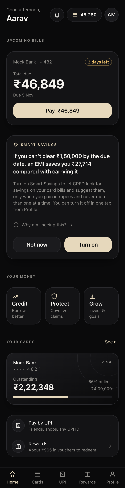 | 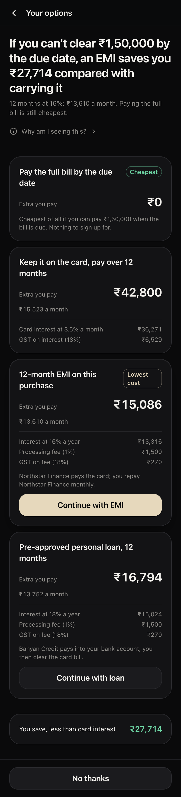 | 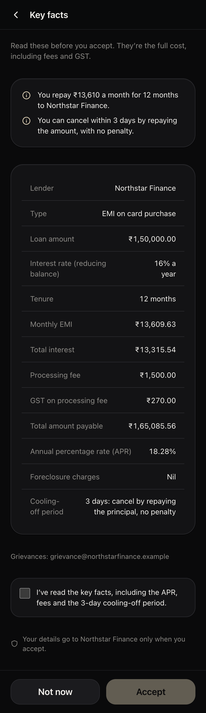 | 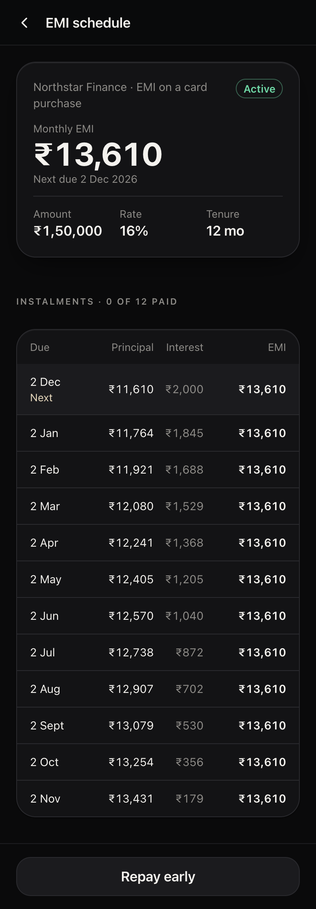 |
|---|---|---|---|
| Step 7 · Smart Savings | Step 10 · options | Step 11 · key facts | Step 13 · schedule |

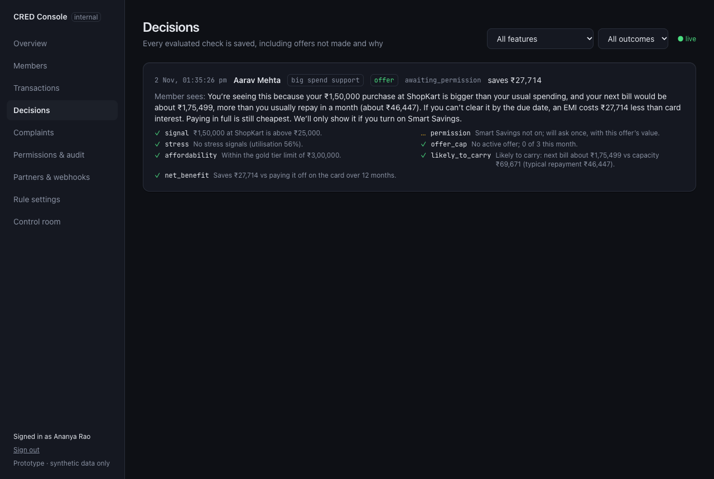

Other key steps: [ShopKart](screenshots/demo-guide/j1-01-product.png) · [checkout](screenshots/demo-guide/j1-01-checkout.png) · [Mock Bank OTP](screenshots/demo-guide/j1-01-bank-otp.png) · [offer card](screenshots/demo-guide/j1-03-offer.png) · [e-sign](screenshots/demo-guide/j1-06-esign.png).

---

## Journey 2 · Aarav buys a ₹38,500 monitor: no offer, then Convert to EMI

**Reset demo**. CRED app as **Aarav Mehta**.

| # | Where | Click | You should see |
|---|---|---|---|
| 1 | ShopKart | **Shopping as** → **Aarav Mehta** → **Switch** → **Studio 27 4K Monitor** (₹38,500) → **Buy now** → **Credit or debit card** → **Mock Bank VISA ···· 4821 (saved)** → **Pay ₹38,500** → Mock Bank: any 6 digits → **Confirm payment** | Order placed. |
| 2 | CRED app | (wait a few seconds) | Home: outstanding ₹1,10,848, and **no offer, no Smart Savings card**. |
| 3 | CRED app | **Profile** tab → **Your data and decisions** | **Nothing suggested**: *"Looks like you'll clear this by the due date, so there's nothing to save. If you'd still like to spread it out, tap Convert to EMI on the purchase."* |
| 4 | CRED app | **Cards** tab → the **•••• 4821** card | Card detail. Under **Recent transactions**, the top row is **ShopKart ₹38,500 · Convert to EMI**. |
| 5 | CRED app | **Convert to EMI** on that ShopKart ₹38,500 row | **Your options**: *"If you can't clear ₹38,500 by the due date, an EMI saves you ₹7,113…"*. Pay in full ₹0 first; 12-month EMI ₹3,493 a month. No permission screen (the member asked). |
| 6 | CRED app | **Continue with EMI** → tick the acknowledgement → **Accept** → type the code → **Confirm** | **EMI schedule**: ₹3,493 a month for 12 months. |

| 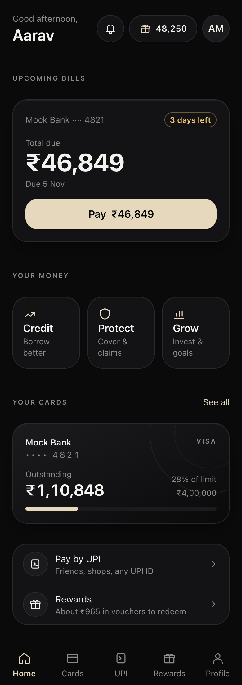 | 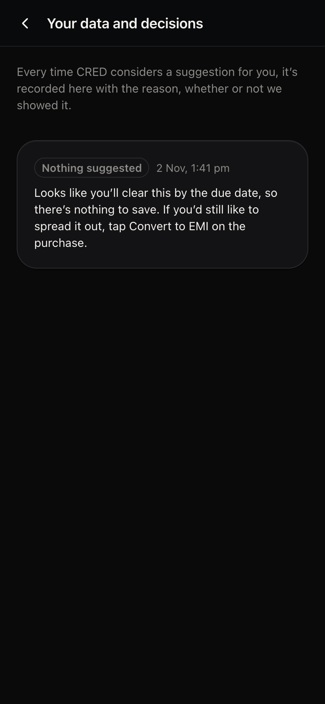 | 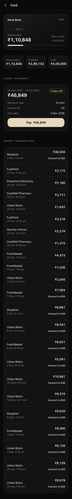 | 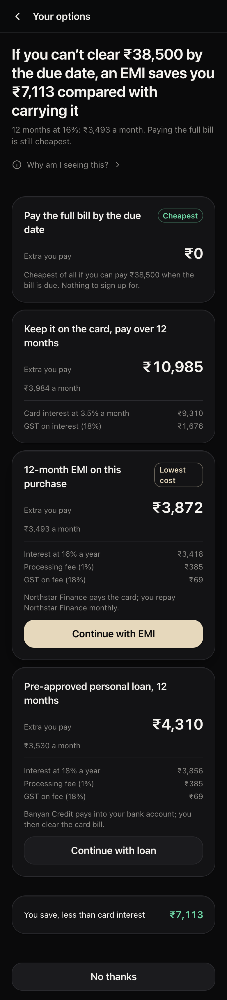 |
|---|---|---|---|
| Step 2 · no offer | Step 3 · why | Step 4 · Convert to EMI | Step 5 · options |

Why there's no offer: the monitor clears the big-purchase bar (₹25,000), but CRED projects Aarav can still clear his next bill. So it doesn't push anything ("likely to carry" fails), and the member can still ask.

---

## Journey 3 · Rohan buys the same laptop: help, not credit, and a pay-down plan on his own card

**No lender is involved.** Rohan pays only the minimum, so a loan would add to his problem. CRED doesn't earn from his card interest, so it shows him the truth and helps him clear it on his own card.

**Reset demo**. CRED app as **Rohan Das**.

| # | Where | Click | You should see |
|---|---|---|---|
| 1 | CRED app | (nothing) | Home: bill ₹78,879 due 5 Nov, outstanding ₹90,212 (36% of a ₹2,50,000 limit). |
| 2 | ShopKart | **Shopping as** → **Rohan Das** → **Switch** → **Aero 14 Laptop** → **Buy now** → **Credit or debit card** → **Mock Bank VISA ···· 9013 (saved)** → **Pay ₹1,50,000** → Mock Bank: any 6 digits → **Confirm payment** | Order placed (the bank approves: he's within his limit). |
| 3 | CRED app | (no refresh) | **No offer.** A **HERE TO HELP** card: *"You're carrying ₹2,40,212 on your card… about ₹9,921 a month in interest… a pay-down plan on your own card can clear it step by step, with no loan"*. Inside it, **THE TRUTH, IN RUPEES**: paying only the minimum takes **35 years** and **₹9,10,050** in interest; Plan 3 months ₹86,761 a month (₹20,069 interest) · 6 months ₹45,989 (₹35,717) · 12 months ₹25,730 (₹68,540). **Talk to us** and **See a plan**. |
| 4 | Console | **Decisions** | Rohan Das · big spend support · **help, not credit** · `stress_signal` (minimum-only payments, partial payments, 96% utilisation). |
| 5 | CRED app | **See a plan** | **Pay-down plan**: the truth table again, with each plan's saving against minimum only (₹8,89,981 · ₹8,74,332 · ₹8,41,510 less), and *"A fixed amount each month to your own card's bank, through bill pay. No loan, no fee."* **Clear it over**: nothing is pre-selected. |
| 6 | CRED app | **₹25,730 a month for 12 months**, tick **I'll aim to pay this amount each month. I can pay just the minimum, or stop the plan, any time.** | **You pay: your own card's bank, through bill pay** · each month ₹25,730 · **Loan or fee: None**. Below: **Stay on track and you'll start unlocking member benefits** (coins, and each on-track month counts towards the credit ladder; 3 in a row reaches Silver). |
| 7 | CRED app | **Start my plan** | **Pay-down plan · 0 of 12 on track** · *"Your plan starts with your next bill. Pay what you can on the current one; the minimum is fine."* |
| 8 | CRED app | **Cards** tab | Under the card: **Pay-down plan** with progress (₹0 paid of ₹2,40,212, *"to your own card. No loan."*). |
| 9 | CRED app | **Profile** → **Your loans** | **No loans.** The plan is not a loan. |
| 10 | Control room | **Rohan** → **Advance a month**, pressed **once** | Clock moves to 2 Dec. Salary arrived; his bank paid the 5 Nov bill's minimum, as he always does. |
| 11 | CRED app | The bell (Alerts) | One reminder: **Your plan amount this month: ₹25,730**. *"Pay it to your card by 5 Dec 2026 to stay on track. If this month is tight, the minimum is fine too."* |
| 12 | CRED app | Home → **Pay** on the bill → **Your plan amount** (₹25,730) → **Pay ₹25,730** | **Payment successful**, to Mock Bank ···· 9013, **+2,570 coins for paying on time**. |
| 13 | Mock Bank portal: http://localhost:3003/bank?c=per_rohan | (nothing) | **CARD BILL UPI XX9013 −₹25,730** from his own salary account, paid to his card at Mock Bank. |
| 14 | Control room | **Rohan** → **Advance a month** (the second press) | Clock moves to 2 Jan; the 5 Dec due date has passed. |
| 15 | CRED app | Cards → the **Pay-down plan** card (or Home → **See a plan**) | **1 of 12 on track**: *"Bill due 5 Dec: ₹25,730 of ₹25,730 · On track"*, next ₹25,730 by 5 Jan, **Pay this month's amount**, **Stop the plan**. |
| 16 | CRED app | Home → **Credit** | The ladder streak is **1**, and the 5 Dec bill shows **On your plan**. No credit line is shown while he's on the plan. |
| 17 | Console | **Overview** | Defaults and strain: **Members on a pay-down plan (own card, no loan; no new credit): 1** and **Pay-down plans on track: 1 of 1**. |
| 18 | Console | **Permissions & audit** | **pay_down_plan.created** for Rohan Das, with `lender: none`. There is no loan and no lender call. |

**Advance a month: 2 presses.** The first lets his salary arrive and creates the first plan bill. The second passes its due date, so it counts as on track.

| 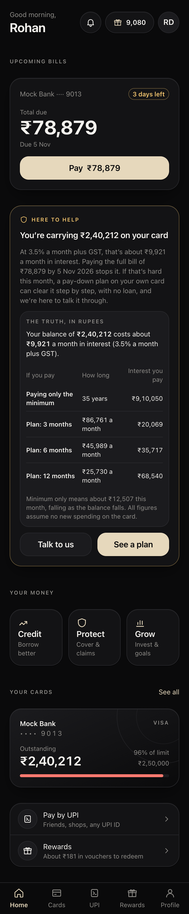 | 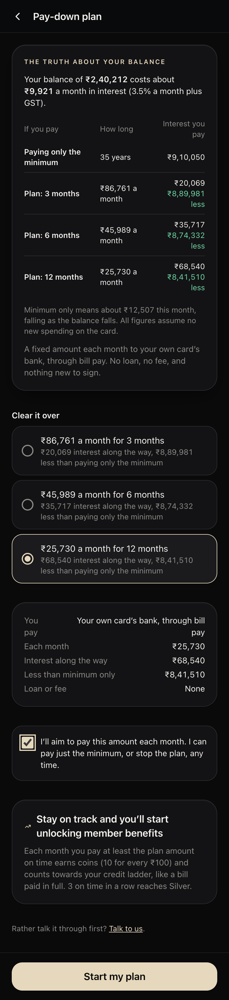 | 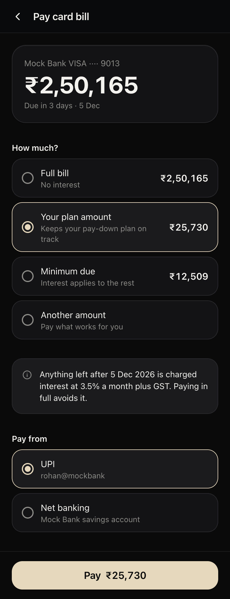 | 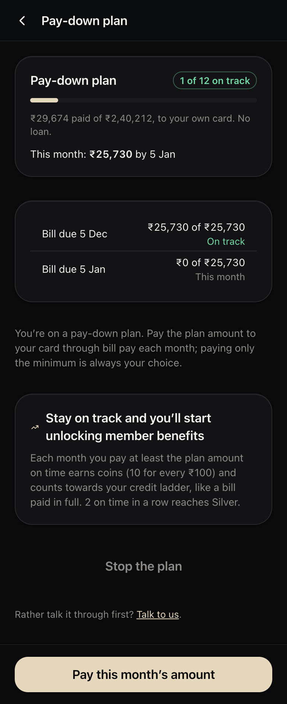 |
|---|---|---|---|
| Step 3 · the truth | Step 6 · 12 months chosen | Step 12 · plan amount | Step 15 · on track |

Also: [admin decision](screenshots/demo-guide/j3-02-admin-decision.png) · [truth and options](screenshots/demo-guide/j3-03-plan-options.png) · [plan started](screenshots/demo-guide/j3-05-plan-started.png) · [under the card](screenshots/demo-guide/j3-06-card-with-plan.png) · [no loans](screenshots/demo-guide/j3-07-no-loans.png) · [reminder](screenshots/demo-guide/j3-08-reminder.png) · [paid](screenshots/demo-guide/j3-10-paid.png) · [Mock Bank](screenshots/demo-guide/j3-11-mock-bank.png) · [ladder](screenshots/demo-guide/j3-13-ladder.png) · [admin overview](screenshots/demo-guide/j3-14-admin-overview.png) · [admin audit](screenshots/demo-guide/j3-15-admin-audit.png).

---

## Journey 4 · Priya adds her parents, sees two quotes, earns ₹1,240 at renewal

**Reset demo**. CRED app as **Priya Nair**.

| # | Where | Click | You should see |
|---|---|---|---|
| 1 | CRED app | Home → **Protect** | Policies: employer cover ₹3 lakh, **Sahaj Family Floater ₹5 lakh · renews 25 Nov**. **Wellness rewards · Score 76 · ₹1,240 off at renewal**. |
| 2 | CRED app | **Family** → **Add someone** → Name **Gopal Menon**, **Parent**, Age **68** → **Add** | Gopal is listed. |
| 3 | CRED app | **Add someone** → **Lakshmi Menon**, **Parent**, **64** → **Add** | Both parents listed. |
| 4 | CRED app | Under **Compare cover**, tick **Gopal Menon** and **Lakshmi Menon**, choose **₹5 lakh** → **Compare from the insurer** | **Two ways to cover them**, **₹19,300 a year less with the cheaper way**: *Add them to your current floater* (extra ₹83,000 a year) vs **A separate floater for them** (extra ₹63,700, **Costs less**), with waiting periods: 30 days, 2 years, 3 years. Don't buy for this journey. |
| 5 | CRED app | Back → **Protect** → **Wellness rewards** | Google Health Connect, **activity score 76 · 5% reward · ₹1,240 off your Sahaj Family Floater at renewal on 25 Nov 2026**. Weekly summaries only. |
| 6 | Control room | **Priya** → **Advance a month**, pressed **once** | Log: 2026-11-02 → 2026-12-02. |
| 7 | CRED app | **Wellness rewards** | **Saved at your renewal on 25 Nov 2026: ₹1,240**. |
| 8 | CRED app | The bell (Alerts) | **Sahaj Family Floater renewed**: *"₹23,560 paid for another year. Your activity saved you ₹1,240 on the premium."* |

**Advance a month: exactly 1 press.** The clock starts on 2 Nov, and one press moves it to 2 Dec, passing the 25 Nov renewal. The insurer collects ₹24,800 − ₹1,240 = ₹23,560. Pressing it twice also works (it's what takes Priya to Gold on the credit ladder), but the reward needs only one.

| 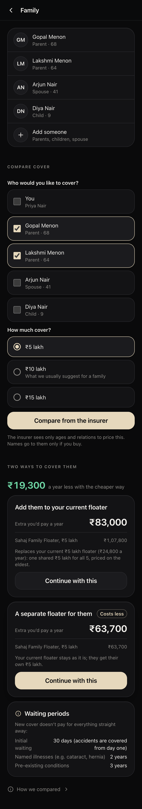 | 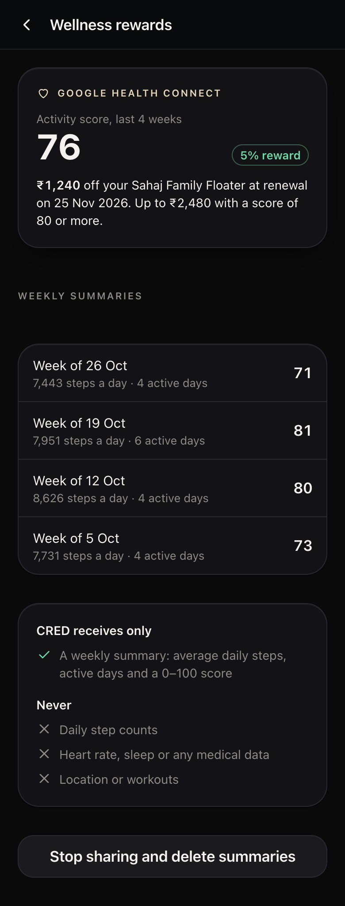 | 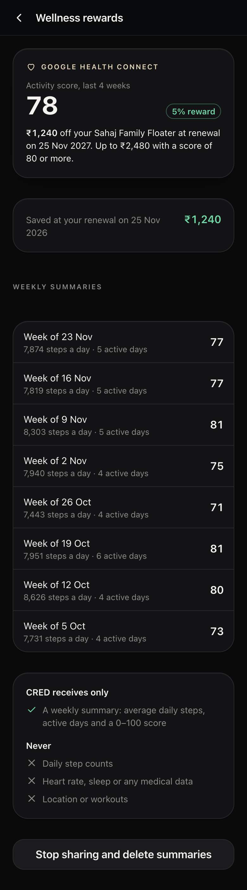 | 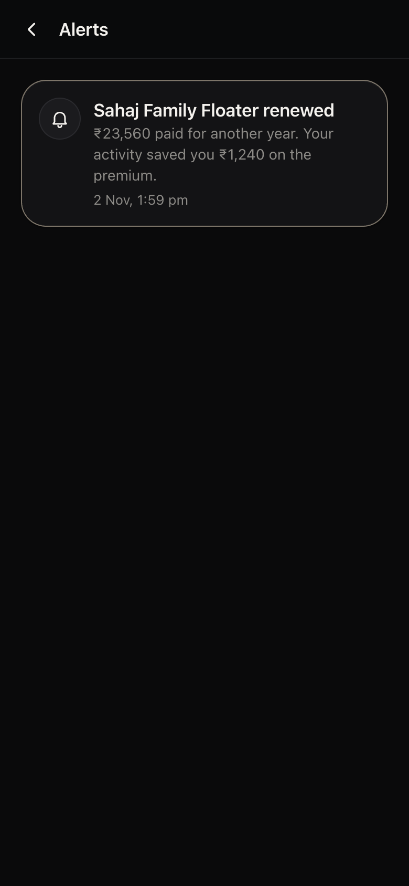 |
|---|---|---|---|
| Step 4 · two quotes | Step 5 · wellness | Step 7 · ₹1,240 saved | Step 8 · renewal alert |

Also: [Protect](screenshots/demo-guide/j4-01-protect.png) · [adding a parent](screenshots/demo-guide/j4-02-add-parent.png) · [compare](screenshots/demo-guide/j4-03-compare.png) · [control room](screenshots/demo-guide/j4-06-advance.png).

---

## Journey 5 · Sneha starts selling a fund, borrows against it instead, then the market falls

**Reset demo**. CRED app as **Sneha Kapoor**.

| # | Where | Click | You should see |
|---|---|---|---|
| 1 | CRED app | Home → **Grow** | **Your money**: total ₹25,63,998, fees disclosed (~₹5,080 a year to fund houses, none to CRED), mix, holdings, the house goal. |
| 2 | CRED app | **Meridian Flexi Cap Fund – Direct Growth** | ₹6,49,998, 7,708.7 units, fund fee 0.62%. **Sell some** at the bottom. |
| 3 | CRED app | **Sell some** → **How much do you need?** **2,00,000** (leave **12 months**) → **See what it costs** | **Sell or borrow?** **₹11,263 less to borrow than to sell.** Sell it: ₹24,000 (no tax, within the ₹1,25,000 allowance; returns given up ₹24,000). Borrow: ₹12,737 (interest 10.5% ₹11,557, fee ₹1,000, GST ₹180). |
| 4 | CRED app | **Borrow instead** | **Your options**: sell vs borrow side by side. *"Keystone Capital holds a lien… Most you can borrow: ₹3,24,998 (50% of its value)."* |
| 5 | CRED app | **Continue with loan** | **Key facts**: **Keystone Capital**, lien on 4,743.834 units, 10.5%, EMI ₹17,629.72, APR 11.62%. |
| 6 | CRED app | Tick the acknowledgement → **Accept** → type the code → **Confirm** | **Keystone Capital · Loan against your holdings**, ₹17,630 a month for 12 months. |
| 7 | Control room | **Sneha** → **Market falls 15%** | Log line for the scenario. |
| 8 | CRED app | The bell (Alerts) | **Your loan is now 59% of your pledged holdings**: worth ₹3,39,991, the lender lends up to 50%, *"Repaying ₹30,005 early, or pledging a little more, brings it back… We can help you choose."* And **Markets fell: your funds are down 10%**: *"Nothing you need to do."* |

**Sneha's loan is funded by Keystone Capital** (the secured lender for loans against holdings), at 10.5% with a 0.5% fee.

Why the alert says 10% when the button says 15%: equity fell 15%, but her debt fund didn't move, so her funds overall fell about 10%.

| 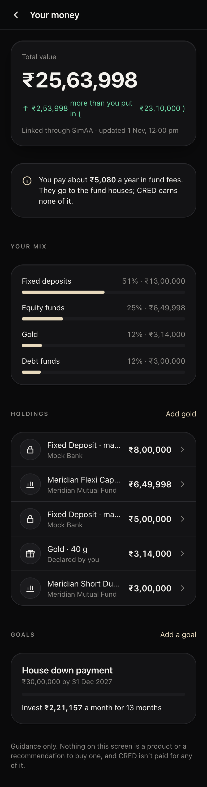 | 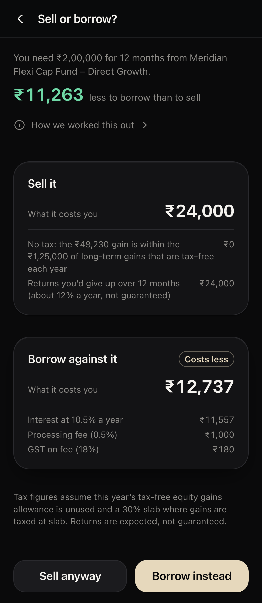 | 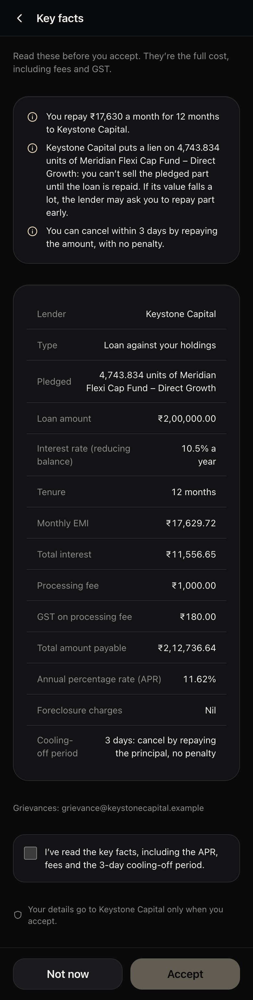 | 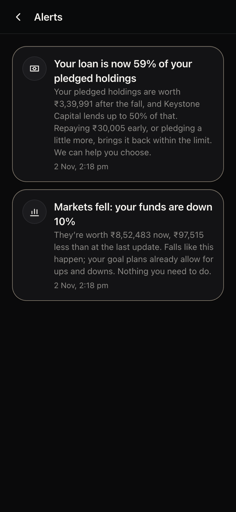 |
|---|---|---|---|
| Step 1 · Wealth | Step 3 · sell vs borrow | Step 5 · key facts | Step 8 · alerts |

Also: [holding](screenshots/demo-guide/j5-02-holding.png) · [amount](screenshots/demo-guide/j5-03-amount.png) · [options](screenshots/demo-guide/j5-05-options.png) · [loan](screenshots/demo-guide/j5-07-loan.png) · [control room](screenshots/demo-guide/j5-08-control-room.png).

---

## Journey 6 · Kabir pays part of his bill: Card-Balance Switch

**Kabir is the right persona.** Smart Savings is on, he has no stress signals (utilisation 35% after paying), and a ₹37,166 balance would carry. Rohan, who also pays part, gets help, not credit.

**Reset demo**. CRED app as **Kabir Singh**.

| # | Where | Click | You should see |
|---|---|---|---|
| 1 | CRED app | (nothing) | Home: bill ₹67,166 due 5 Nov. No offer. |
| 2 | CRED app | **Pay** on the bill | **Pay card bill**: Full bill ₹67,166 · Minimum due ₹3,359 · Another amount. Nothing is pre-selected. |
| 3 | CRED app | **Another amount** → Amount **30000** → **UPI** → **Pay ₹30,000** | **Payment successful** ₹30,000, +3,000 coins, **Left on this bill ₹37,166**, on time. |
| 4 | CRED app | **Done** | Home: bill **Part paid**, and a **SMART SAVINGS** card: *"If you carry the remaining ₹37,166, moving it to an EMI saves you ₹3,223…"*, *"6 months from 17%: ₹6,505 a month, and the rate steps down when you pay on time."* |
| 5 | CRED app | **Compare** | Pay the rest ₹0 (Cheapest) · keep it on the card ₹5,526 · **6-month EMI** ₹2,303 (Lowest cost). The rate steps down to 16% after 2 on-time EMIs, then 15% after 4. |
| 6 | CRED app | **Continue with EMI** | **Key facts**: card balance moved to an EMI, Northstar Finance, the step-down rates listed. |
| 7 | Console | **Decisions** | Kabir Singh · card balance switch · offer · saves ₹3,223, every check ticked. |

| 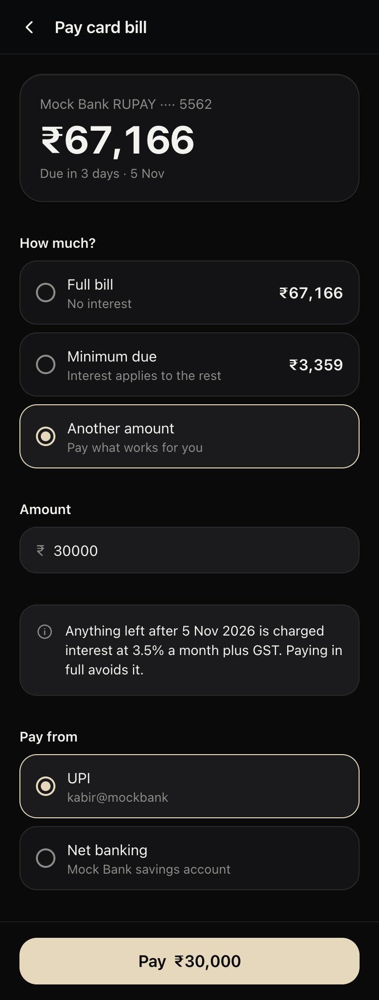 | 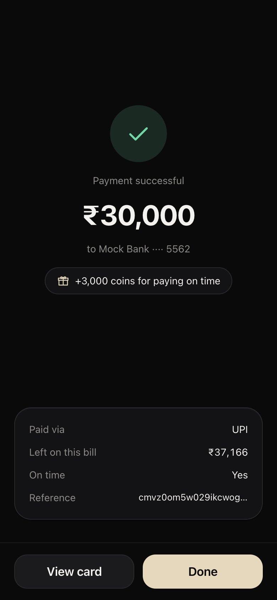 | 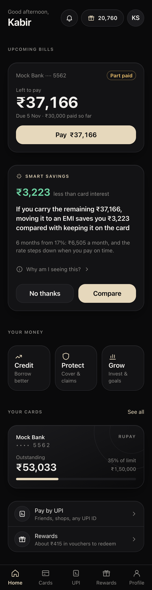 | 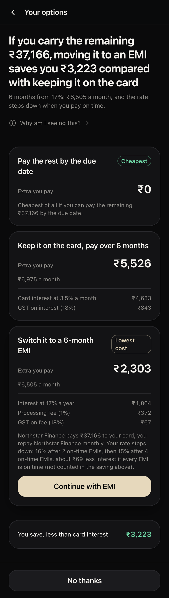 |
|---|---|---|---|
| Step 3 · part payment | Step 3 · success | Step 4 · switch offer | Step 5 · options |

Also: [key facts](screenshots/demo-guide/j6-06-key-facts.png) · [admin decision](screenshots/demo-guide/j6-07-admin-decision.png).

---

## Journey 7 · Privacy: one-tap off, what CRED knows, your data and decisions

**Reset demo**. Use **Kabir**, so there's an offer to watch disappear.

| # | Where | Click | You should see |
|---|---|---|---|
| 1 | Control room | **Kabir** → **Pay part of the bill** | Log: paid 40% of the bill in CRED. |
| 2 | CRED app (as Kabir) | Home | The switch offer from his part payment (*"If you carry the remaining ₹40,300…"*). |
| 3 | CRED app | **Profile** tab → **Privacy** | **Permissions**, **What CRED knows about me**, **Your data and decisions**, **Download my data**, **Privacy notice**, **Delete my data**. |
| 4 | CRED app | **Permissions** | **Smart Savings · On** with **Turn off**. |
| 5 | CRED app | **Turn off** (one tap) | **Smart Savings · Off · Turned off 2 Nov 2026**. |
| 6 | CRED app | **Home** tab | The offer is **gone**. Proactive offers stop at once. |
| 7 | CRED app | **Profile** → **Privacy** → **What CRED knows about me** | About you, card and bills (27 purchases, 7 bills), payments and rewards, decisions (1), and **What CRED never holds** (card number, UPI PIN, raw bank transactions, health data…). |
| 8 | CRED app | Back → **Your data and decisions** | **Suggested · 2 Nov**: the plain-English reason for the switch offer. |
| 9 | Console | **Permissions & audit** | Permission log: Kabir Singh · member · **permission.withdrawn** · smart_savings. |

| 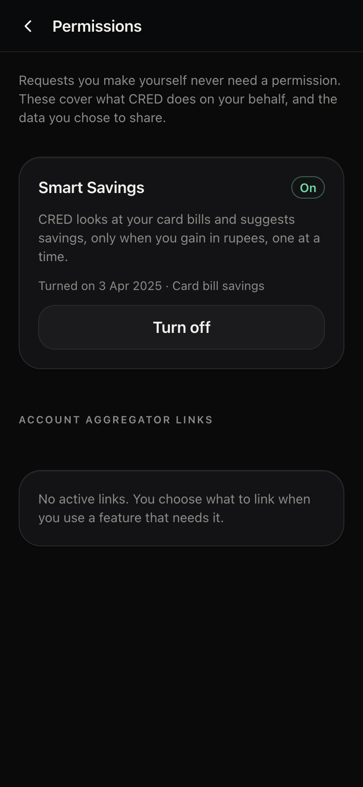 | 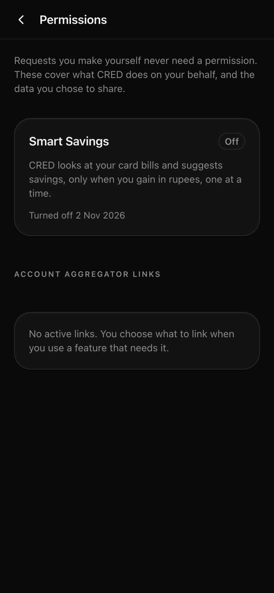 | 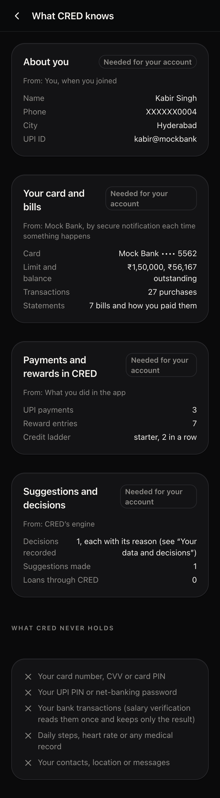 | 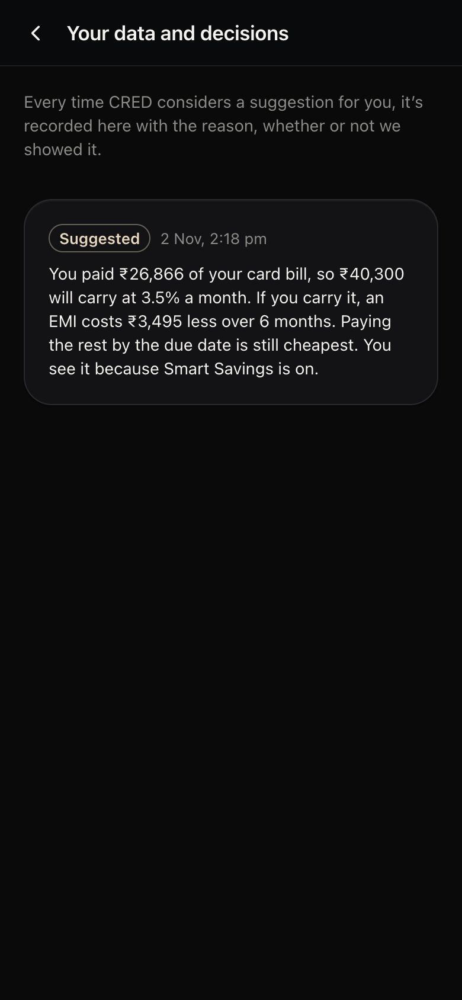 |
|---|---|---|---|
| Step 4 · permissions | Step 5 · turned off | Step 7 · what CRED knows | Step 8 · decisions |

Also: [offer before](screenshots/demo-guide/j7-01-home-offer.png) · [privacy](screenshots/demo-guide/j7-02-privacy.png) · [home after](screenshots/demo-guide/j7-05-home-after.png) · [admin audit](screenshots/demo-guide/j7-08-admin-audit.png).

---

## Journey 8 · Console: the funnel, why offers weren't made, and a rule change

**Reset demo**. A fresh reset has no decisions, so make a few first.

| # | Where | Click | You should see |
|---|---|---|---|
| 1 | Control room | **Aarav** → **₹1.5L laptop on the card**, and press it **twice** | Two log lines. |
| 2 | Control room | **Rohan** → **₹1.5L laptop on the card** | Log line. |
| 3 | Control room | **Sneha** → **₹1.5L laptop on the card** | Log line. |
| 4 | Control room | **Priya** → **New car, comprehensive** | *"A new car from Velocity Motors…"* |
| 5 | Console | **Overview** | Offers shown → accepted **1 → 0**; **Decided not to offer: 3**, plus 1 that got help instead of credit. **Offer funnel by feature**: Big Spend Support with offers, awaiting permission, shown, help, and **Not offered, by reason**: `no_permission ×1` (Aarav's second laptop: he was asked about Smart Savings minutes ago and isn't asked again for 90 days) and `no_signal ×1` (the car booking isn't a big purchase). Protection Gap: `already_covered ×1` (the car came with comprehensive cover, so nothing is suggested). |
| 6 | Console | **Rule settings** → **Minimum big purchase** (₹25,000) → **Edit** | Two fields: **New value (₹)** and **Reason (logged)**. **Save** stays disabled until a reason is typed. |
| 7 | Console | New value **30000**, reason *"Class demo: raising the big-purchase bar"* → **Save** | The rule now shows **₹30,000**, marked changed. |
| 8 | Console | **Permissions & audit** | Audit log: **rule.changed** · bigSpendMinPaise, from/to, the reason, and Ananya Rao's name. |

Values outside the allowed range are refused (₹5,000–₹5,00,000 for this rule). **Reset demo** puts every rule back.

| 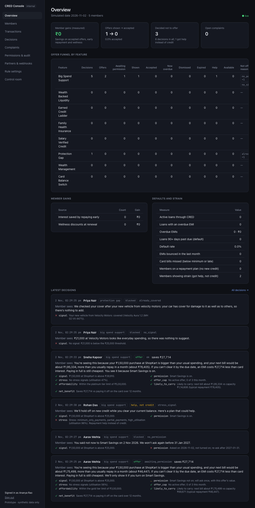 | 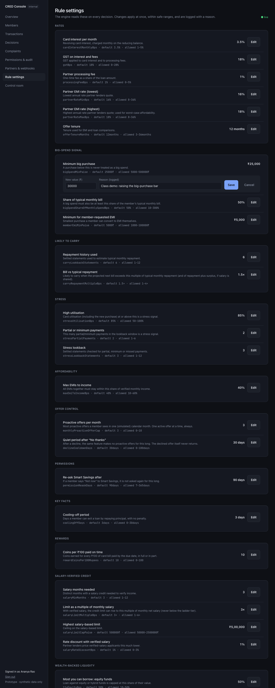 |
|---|---|
| Step 5 · funnel and reasons | Step 7 · rule edit with a reason |

Also: [control room](screenshots/demo-guide/j8-01-control-room.png) · [saved](screenshots/demo-guide/j8-04-rule-saved.png) · [audit](screenshots/demo-guide/j8-05-audit.png).
